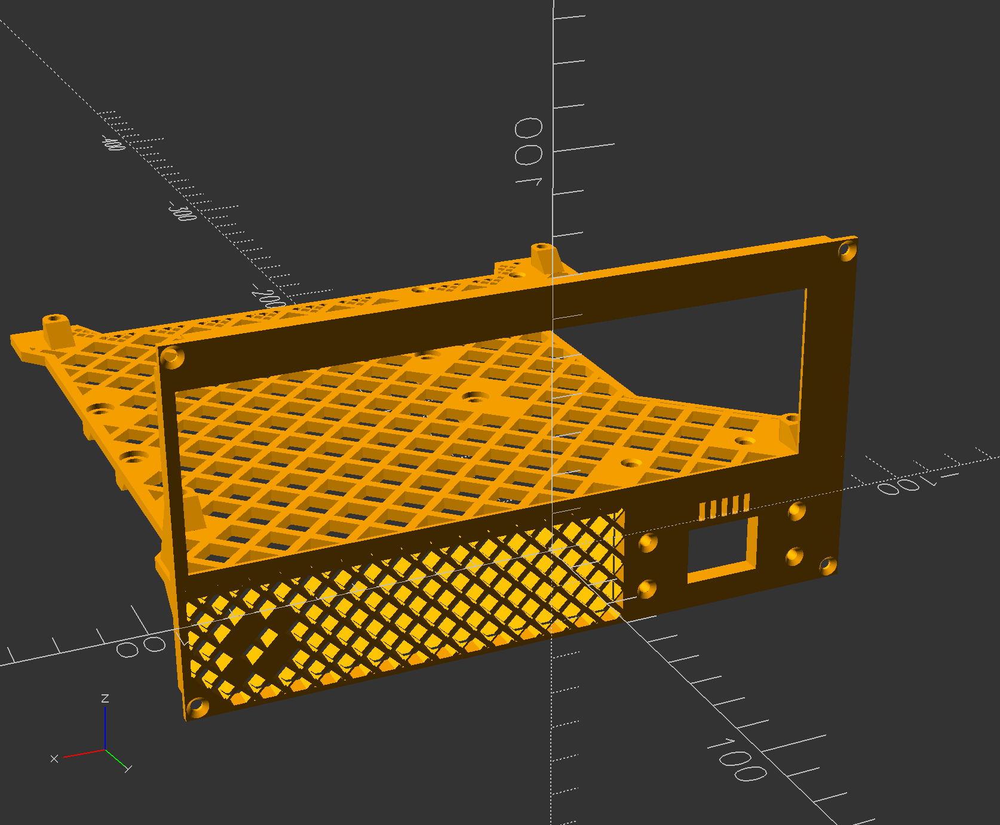
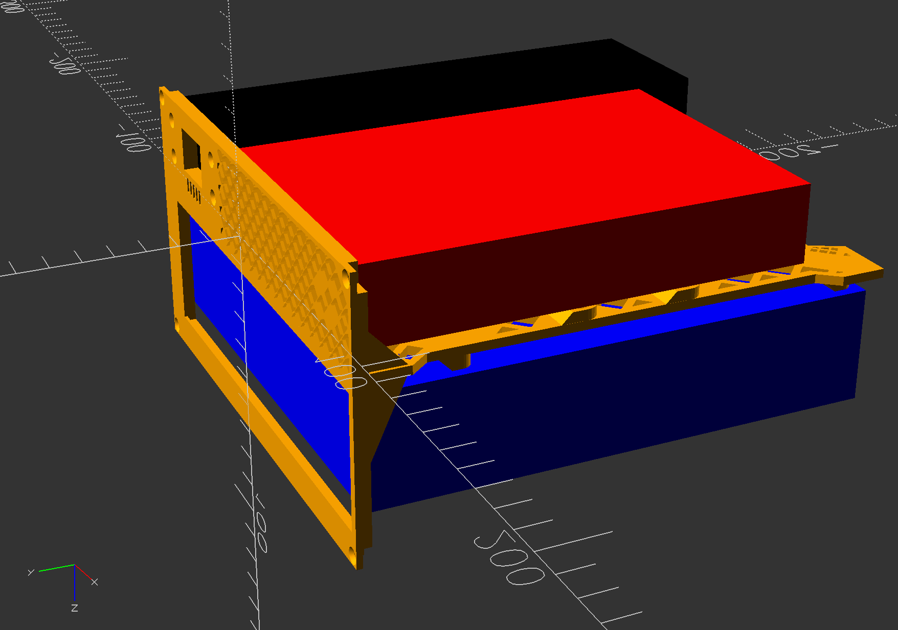
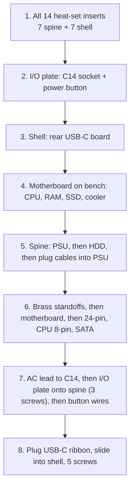

# Game of Life ITX Case — ITX Layout Study



A parametric OpenSCAD model built around the ["4.7L Mini ITX case, easily
printable (2 major pieces)"](https://www.printables.com/model/143897-47l-mini-itx-case-easily-printable-2-major-pieces)
design. The original pairs a fish-shaped **spine** (structural divider +
motherboard standoffs) with an outer **shell**. This project keeps the
spine's "sandwich" concept — a divider plate between a motherboard
compartment and a lower compartment — but redesigns the lower compartment
around different hardware:

- **GPU → 3.5" HDD**, vibration-isolated on O-rings
- **ATX/FlexATX PSU → HDPLEX 250W GaN AIO ATX PSU**, thermally isolated on O-rings
- Board: **ASRock B860I** (Mini-ITX)

The outer shell is redesigned too (`shell.scad`, see
[Outer shell](#outer-shell)): a rounded tube closed at the front, printed
front face down, that the spine + I/O plate assembly slides into.

**`flat_print` branch:** the spine and the front plane are two separate
parts, each printed flat and joined by M3 flat-head screws into heat inserts
(see [Spine ↔ I/O plate joints](#spine--io-plate-joints)). The printed MB
standoffs are replaced by metal M3 standoffs.

## Contents

1. [Files](#files)
2. [Using the model](#using-the-model)
3. [Conventions](#conventions)
4. [Design reference](#design-reference)
   - [Enclosure and front face](#enclosure-and-front-face)
   - [Divider plate](#divider-plate)
   - [Standoffs](#standoffs)
   - [Front panel — upper (rear I/O)](#front-panel--upper-rear-io)
   - [Front panel — lower (HDD / PSU side)](#front-panel--lower-hdd--psu-side)
   - [Front panel mounting screws](#front-panel-mounting-screws)
   - [Spine ↔ I/O plate joints](#spine--io-plate-joints)
   - [Spine channel ribs](#spine-channel-ribs)
   - [CPU cooler and fan intake clearance](#cpu-cooler-and-fan-intake-clearance)
   - [PSU 24-pin routing (SC Shift adaptors)](#psu-24-pin-routing-sc-shift-adaptors)
   - [Outer shell](#outer-shell)
5. [Printing](#printing)
   - [Orientation](#orientation)
   - [Flat-part slicer profiles](#flat-part-slicer-profiles)
   - [Tested profile](#tested-profile)
   - [Why these settings](#why-these-settings)
   - [If it still wobbles](#if-it-still-wobbles)
   - [Before slicing](#before-slicing)
6. [Hardware and assembly](#hardware-and-assembly)
   - [Hardware](#hardware)
   - [Assembly steps](#assembly-steps)
   - [Hardware details](#hardware-details)
7. [Self-checks (console warnings)](#self-checks-console-warnings)
8. [Known open items](#known-open-items)

## Files

| File | Purpose |
|---|---|
| `case_common.scad` | The shared model: every parameter and module (was `game_of_life_itx_case.scad`). Renders the live assembly (both parts) when opened directly; edit parameters here. |
| `spine.scad` | Renders the **spine** part (Orange) plus `io_plate.stl` in grey. Exports `spine.stl`. |
| `io_plate.scad` | Renders the **I/O plate** — the whole front plane: rear I/O, HDD grill, C14 (Orange) plus `spine.stl` in grey. Exports `io_plate.stl`. |
| `shell.scad` | Renders the **outer shell** around the live spine + I/O plate (Orange), the cooler block, the rear USB-C board and the power button. Exports `shell.stl`. See [Outer shell](#outer-shell). |
| `c14_tool.scad` | Included by the main file. Cutting tools for the C14 inlet (flange lip + body), with per-axis fit trims. Profiles auto-generated from `c14_socket.stl`. |
| `asrock_b860i_io_shield.scad` | Caliper-measured rear-I/O port layout for the ASRock B860I. Exported to `asrock_b860i_io_shield.stl`, which the main file imports and cuts into the front panel. |
| `c14_socket.stl` / `c14_snap-fit_socket.stl` | C14 inlet models (screw-mount / snap-in), selected by `USE_SNAP_IN_C14`. |
| `4.7-Fish_-_spine.stl` | Original spine reference. Front I/O opening, mounting holes, and taper shape were measured from it. |
| `4.7-Fish_-_case.stl`, `4.7-fish-step.step` | Original shell / STEP reference — not used in the model yet. |
| `asrock_b760m_itx_io_shield.scad`/`.stl`, `basic_layout.scad` | Legacy: the previous board's shield model and an early layout snapshot. Not used. |
| `print/game_of_life_itx_case_0.25mm_STRUCTURAL_PETG_MK4S.3mf` | PrusaSlicer project with the [tested print profile](#tested-profile). Embeds the Sep 29 mesh — reload the STL from disk before slicing. |
| `game_of_life_itx_case_0.4n_0.25mm_PETG_MK4S_4h2?m.bgcode` | **Stale:** Sep 25 slices with the stock profile (2 perimeters, 15 % grid) and old geometry. |

## Using the model

- Requires OpenSCAD **≥ 2021.01** (function literals are used for the -Y
  taper breakpoints). The manifold backend (`--backend=manifold`) is much faster.
- `used_components` toggles `SHOW_MB` / `SHOW_HDD` / `SHOW_GAN_PSU` /
  `SHOW_C14_SOCKET` together — translucent reference bodies for clearance
  checks. **Set it `false` before exporting.**
- `SHOW_SPINE` imports the *original* reference STL in a comparison pose;
  most "real" measurements were taken against it. Not part of the print.
- `SHOW_ODD` / `ODD_*` is a leftover slim-optical-drive placeholder, unused.
- `SHOW_GAN_BLOCKS` shows the SC Shift adaptor bodies and enables their
  report (see [PSU 24-pin routing](#psu-24-pin-routing-sc-shift-adaptors)).
- **Edit in `case_common.scad`.** Every parameter lives there (e.g.
  `SPINE_PANEL_SCREW_X` for the joint positions). Opened directly it shows
  the live assembly, both parts rebuilt from the current parameters, so a
  change shows on both at once without re-exporting. `ASSEMBLY_PREVIEW`
  switches this off; the part files set it `false`. Don't export from here.
- **Two part files.** Open `spine.scad` or `io_plate.scad`; each includes
  `case_common.scad`, renders its part in Orange and, with
  `SHOW_OTHER_PART = true`, imports the *other* part's STL in grey (world
  coordinates, so they line up). A missing STL only gives an import warning.
  The grey part is the last export, so re-export after changing parameters.
- **Export:** `SHOW_OTHER_PART = false` and `used_components = false` (the
  grey import and the component boxes would otherwise end up in the STL;
  a `NOTE:` echoes while the grey part is shown), then a full **Render
  (F6)** — the lightening pattern is slow and can be wrong in Preview. CLI:
  ```
  openscad --backend=manifold -D used_components=false -D SHOW_OTHER_PART=false -o spine.stl spine.scad
  openscad --backend=manifold -D used_components=false -D SHOW_OTHER_PART=false -o io_plate.stl io_plate.scad
  openscad --backend=manifold -D used_components=false -D SHOW_ASSEMBLY=false -D FOR_PRINT=true -o shell.stl shell.scad
  ```
  The spine and I/O plate STLs are in world coordinates; orient them in the
  slicer (see [Printing](#printing)). `FOR_PRINT` already lays the shell
  front face down at z = 0.
- After any change, **read the console for `WARNING:` lines** (see
  [Self-checks](#self-checks-console-warnings)).

## Conventions

- **Real vs free numbers.** Most dimensions come from a verifiable source
  (datasheet, spec, manufacturer STEP, caliper, or the reference STL).
  Others are free design choices. This README records which is which (the
  code keeps only terse inline notes). When a free parameter is *meant* to
  track a real value, the model computes that value each render and echoes a
  `WARNING:` on drift instead of silently overriding you.
- **Literals that can't be derived.** OpenSCAD evaluates top-level
  assignments in order, so a few positions are literals that depend on
  things defined later (`MB_POS[1]`, `GAN_PSU_POS[2]`, `ENCLOSURE_*` Z). Each
  has a drift warning that prints the value to set.
- **Manifold ≠ connected.** A watertight union can still contain disjoint
  bodies. Verify connectivity with STL-intersection probes:
  `intersection() { import("model.stl"); translate([x,y,z]) cube(s); }` —
  empty output where there should be material means something is loose.
- **Naming.** `PX`/`NX`/`PY`/`NY`/`PZ`/`NZ` = +X/-X/+Y/-Y/+Z/-Z edge or side.
  `UPPER`/`LOWER` = Z (MB side / HDD-PSU side).
- **Axes.** Front face at Y = 0, the case extends toward -Y. +Z is the MB
  side of the plate, -Z the HDD/PSU side.
- **Print orientation matters** — see [Printing](#printing) before assuming
  a design choice is arbitrary.

## Design reference



### Enclosure and front face

`ENCLOSURE_SIZE = [170.5, 184, 94.96]` @ `ENCLOSURE_POS = [2.75, -93, 16.02]`
is the outer volume budget and defines the front face's X and Z extent. The
shell's inner wall sits `SHELL_FIT_CLEARANCE` (0.2) outside it.

- **X: -82.5 .. 88.** +X is flush with the MB PCB. The Sep 25 test print
  (170 wide @ X 3) had the board flush on +X but ~1 mm past the face on -X,
  so the face grew 0.5 mm on -X only (free, from the test fit).
- **Y: 0 .. -184** — 178 + `SPINE_PLATE_REAR_EXT` (6) for SATA / power
  cable room behind the boards.
- **Z: -31.46 .. 63.5** (the panel itself tops out at `FRONT_PANEL_TOP_Z` =
  62.2, see [fan clearance](#cpu-cooler-and-fan-intake-clearance)). The top
  grew 3 mm with `CPU_COOLER_FIT_OFFSET`. The bottom sits
  `FRONT_PANEL_PSU_CABLE_GAP` = **10.5 mm** below the PSU's bottom
  face (-20.96) — bend room for the 24-pin cable (free). History: 85 → 94
  (+9 on -Z for cable room) → 91.83 (trimmed to the 10.5 mm target) → 91.96
  (+0.13 when the GaN PSU moved to the HDD's thicker O-ring) → 94.96 (+3 on
  +Z, cooler test fit). `front_panel_lower()` warns if the gap drifts.
- When the bottom moved, the HDD grill's bottom margin and the C14 moved
  with it (see [lower panel](#front-panel--lower-hdd--psu-side)); the lower
  mount screws follow the edge automatically.
- The +3 mm top only moved the top edge and the upper mount screws (still
  5 mm from the edge); the I/O cutouts hang off the board and didn't move.
- **Rounded corners** (`FRONT_PANEL_CORNER_ROUND`): the I/O plate's outline
  is the shell's inner outline minus `SHELL_FIT_CLEARANCE`, so its corners
  follow the shell's smoothed corners (see [Outer shell](#outer-shell)).
  Square corners would poke through the shell wall. `front_panel_corner_checks()`
  echoes the material left around each corner screw (≈1.1 mm) and warns
  under 1 mm.

### Divider plate

#### Position and extent

`SPINE_PLATE_POS = [2.31, -89.75 - EXT/2, 8.1]`, `SPINE_PLATE_SIZE = [170.6, 174.5 + EXT, 3]`
with `EXT = SPINE_PLATE_REAR_EXT` = 6: plate Z 6.6 .. 9.6, Y -2.5 .. -183.

- **Rear extension** (`SPINE_PLATE_REAR_EXT`, free): 6 mm more spine at the
  back for SATA and power cables. The front edge stays put. The rear-referenced
  taper values (`PX_AFTER`, `NX_AFTER`, `NY_DEPTH`, `NY2_DEPTH`) each add
  `EXT`, so the notches keep their positions relative to the boards.
- **The front edge butts against the I/O plate's back face** (Y −2.5 =
  −(`FRONT_PANEL_THICKNESS` + `SPINE_PANEL_GAP`), gap 0, free). It's a
  literal because the panel is defined later; the spine warns with the
  values to set if it drifts. (On `main` the edge overlapped the panel by
  0.5 mm, because the two were one print.) The PX/NX taper `BEFORE` runs
  are measured from this edge, so they sit 0.5 mm further back than on
  `main`.
- **X extent** comes from `SPINE_PLATE_NX_X` / `SPINE_PLATE_PX_X` (derived:
  2 mm inside each MB edge, 166 mm wide), superseding `POS`/`SIZE` X and
  `SPINE_PLATE_MARGIN_X`.

#### Edge tapers

The outline copies the reference STL's trapezoidal notches on the three
non-I/O edges, plus an optional second -Y notch:

| | `*_BEFORE` | `*_RUN` | `*_AFTER` | `*_DEPTH` |
|---|---|---|---|---|
| **+X** `SPINE_PLATE_TAPER_PX_*` | flat run from the front | Y-run of each slope | flat run from the back | X-depth into the plate |
| **-Y** `SPINE_PLATE_TAPER_NY_*` | flat run from the -X end | X-run of each slope | flat run from the +X end | Y-depth into the plate |
| **-Y #2** `SPINE_PLATE_TAPER_NY2_*` | same as -Y | same | same | same |
| **-X** `SPINE_PLATE_TAPER_NX_*` | flat run from the front | Y-run of each slope | flat run from the back | X-depth into the plate |

- `RUN` values were measured from the reference STL; `BEFORE`/`AFTER`/
  `DEPTH` are free.
- `PX_DEPTH` defaults to flush with the HDD standoffs, `NY_DEPTH` to flush
  with the GaN standoffs' -Y edge; `NY_DEPTH` warns when it no longer is.
- **NY2** is an independent second notch on the back edge
  (`SPINE_PLATE_TAPER_NY2_ENABLE`). The -Y edge is the *deeper* of the two
  cuts at every X, so the notches may sit apart, touch, or overlap. The
  edge is traced through the breakpoints of both tapers plus any point where
  their slopes cross (`spine_plate_ny_breaks()`); the outline and the
  lightening boundary share that list, so they always agree. With NY2
  disabled the geometry is identical to the single-taper version.
- **Checks:** `BEFORE + 2·RUN + AFTER` must fit the edge (else the outline
  self-intersects); every taper warns if it cuts past any MB/HDD/GaN
  standoff (the -Y check samples the edge across the standoff's whole width,
  so a slope under it is caught).
- Keep every taper that faces -Y at **RUN ≥ DEPTH** (≤ 45°) — with -Y up in
  the print, steeper tapers overhang.

#### Lightening pattern

`SPINE_LIGHTENING_MODE` (`"diamond"` default, or `"honeycomb"`) cuts a
pattern through the plate.

| Mode | Cell params | Notes |
|---|---|---|
| `"diamond"` | `SPINE_GRID_SLOT_W/H`, `SPINE_GRID_WALL` | Square grid rotated 45° — every wall is a short diagonal, no supports needed. Fewer, larger cells. **Default.** |
| `"honeycomb"` | `SPINE_HONEYCOMB_HEX_R`, `SPINE_HONEYCOMB_WALL` | Best open area per wall; slowest to print. |

A plain axis-aligned grid was removed: with -Y up, any wall running purely
along X becomes a full-width unsupported bridge.

- **Where it stops:** `SPINE_LIGHTENING_MARGIN_PX/NX/PY/NY`, independent,
  may be 0 or negative. PX/NX/NY follow their taper's real edge
  (`spine_plate_*_edge_points()`); PY is a flat line.
- **Applied as an axis-aligned box, not an `offset()` of the outline.** An
  outline `offset()` once left razor-thin through-slivers at the notches'
  reflex corners (a numerical artefact). If you reintroduce one, re-verify
  all notch corners with a full render and probes.
- **Standoff protection:** each standoff's peg *and* its print ramp stay
  solid. Cells aren't clipped by CSG; `grid_2d()`/`honeycomb_2d()` compute
  each cell's world position and skip any whose centre comes within
  `apothem − SPINE_LIGHTENING_STANDOFF_PROTECT_FUDGE` (0.3) of a footprint,
  so protected cells stay whole. `standoff_lightening_protect()` builds the
  footprints and drops standoffs already inside the solid margin (otherwise
  they leave a jog in the margin edge).
- **-Y inlay:** in diamond mode, cut cells whose circumradius reaches the
  -Y boundary are subdivided at `SPINE_LIGHTENING_NY_INLAY_SCALE` (0.4; 0 =
  off), so the clip halves small diamonds instead of big ones.

#### Tiling helpers

`honeycomb_2d()` / `grid_2d()` tile an oversized field and intersect it with
a `[w, h]` rectangle. `honeycomb_2d()` tiles on `r_tile = hex_r + wall/√3`
so the gap between neighbours is exactly `wall` in every direction;
flat-top hexes (`$fn = 6`) tile in columns offset by half a row.
`world_rot`/`world_translate` map cell centres into the frame the protect
data was computed in. `grid_2d()` also takes `inlay_edge_pts`/`inlay_scale`
and recurses once to subdivide a cell near that polyline.

### Standoffs

The HDD and GaN standoffs hang off the plate's underside, built along Z.
Printed flat (MB face down) they grow straight up; the 45° `standoff_ramp()`
on each +Y side (`STANDOFF_RAMP_RUN_FACTOR`, 1.0 = 45°) is left over from the
upright print and is no longer needed.

#### Motherboard (M3, metal standoffs)

- **Holes** (`MB_HOLES_RAW`): standard mITX pattern. Edge insets are 5.84 mm
  (-X) / 6.86 mm (+X). `MB_HOLES_X_SHIFT` moves only the standoff pattern
  (and so the board), not the panel; it is 0 = the Sep 25 print, where +X
  sat flush. The ~1 mm -X overhang was fixed by widening the face instead
  (1.02 was never printed and would push +X ~1 mm proud).
- **Height:** plate top 9.6 → PCB underside 15.6 (6 mm). `MB_STANDOFF_H` = 6.0
  (real part) is checked against `MB_POS[2]`; on a mismatch the spine warns
  with the `MB_POS[2]` to use. The I/O cut-outs follow `MB_POS`, so after
  changing it they move with the board.
  `MB_POS[1]` = -`FRONT_PANEL_THICKNESS` - `MB_PANEL_GAP` - 85 = -87.8
  (PCB edge 0.3 mm behind the panel; was -90 / 2.5 mm).
- **No printed standoffs.** Removing them leaves the MB face flat, which is
  what lets the spine print MB face down (the only support-free flat
  orientation — the HDD/GaN standoffs hang off the other face).
- **M3 × 4 insert in a boss under the plate:** the same insert as the
  [joints](#spine--io-plate-joints) — one part for the whole build
  (`SPINE_PANEL_INSERT_DIA/LEN` follow `MB_INSERT_HOLE_DIA/LEN`). The Ø3.6
  bore runs `MB_INSERT_LEN` 4.0 + `MB_INSERT_EXTRA` 0.9 down from the MB face,
  open below; `mb_insert_bosses()` (Ø7.2, 0.5 mm chamfer) extends the plate
  under each hole to the bore bottom, Z 4.7 — 1.9 mm below the plate. Printed
  MB face down, the bosses grow straight up. What sets the limit:

  | MB hole | Below | Boss clearance | Longest insert that would fit (not the one to buy) |
  |---|---|---|---|
  | −X front (−76.16, −12.33) | C14 body (top 1.17) | 3.53 | M3×5.7 |
  | −X rear (−76.13, −166.93) | HDD (top 3.08) | 1.63 | M3×5 |
  | +X front / rear (81.14, …) | GaN PSU corner (top 4.04, PSU X ≤ 80) | **0.66** | **M3×4** |

  `mb_boss_checks()` echoes each and warns under `SPINE_PANEL_MIN_CLEARANCE`.
  The −X front boss merges with the X −70 joint boss; the bores stay 2.2 mm
  apart.
- **Metal standoff:** **M3 × 6 mm brass hex, male–female, male thread 3–4
  mm** (often listed as "M3×6+3" / "M3×6+4"). The male end screws straight
  into the M3×4 insert; 6 mm (body, excluding the thread) keeps the PCB
  underside at Z 15.6, so the I/O alignment is unchanged.
  - **Male thread length matters** — the bore is open below the boss (4.9 mm
    deep), so anything longer sticks out under it. Gap to the GaN PSU at the
    two +X holes: 3–4 mm → stays inside (0.66 boss clearance), 5 mm →
    **0.56** (too tight for real-world thread tolerance), 6 mm (the common
    "M3×6+6") → **hits by 0.44**. Measure before installing.
  - **Fallback:** M3 × 6 female–female + an **M3 × 5 set screw** (ISO 4026;
    4 mm in the insert, 1 mm in the standoff). Same height, one more part.
  - ATX case standoffs are 6-32 × M3 and ¼" (6.35 mm) tall — wrong thread
    for the insert and 0.35 mm too tall.
- **Ring:** `MB_INSERT_RING_R` = hole/2 + `MB_INSERT_MIN_WALL` = 3.6 mm stays
  solid in the lightening pattern; the hex (6.35 mm across corners) sits on
  it.

#### HDD (6-32 UNC, O-ring isolated)

- **Holes** (SFF-8301 Rev 1.9, Fig 3-1 / Table 3-1): A5 = 3.18 in from each
  long side (95.25 across); A7 = 41.28 from the connector end (-Y) to the
  first pair; A13 = 76.20 from *that pair* to the far pair (A6 = 44.45 for
  drives with only the middle pair). Seagate Exos uses A7 + A13 → a
  95.25 × 76.20 rectangle. (A13 was once wrongly measured from the drive
  end, putting the second pair only 34.92 mm behind the first.)
- `HDD_STANDOFF_R` 5, bore `HDD_STANDOFF_HOLE_R` 2.3, O-ring pocket
  `HDD_ORING_POCKET_DEPTH` 1.56 (~12.5% compression of AS568-007).
- **Pass-through access:** screws go in from the MB side, through the
  plate and standoff, into the drive's own threads.

#### GaN PSU (M3 nylon flat heads, O-ring thermal break)

- **Holes** (`GAN_PSU_HOLES`) from HDPLEX's STEP ("same as HDPLEX 200W /
  400W ACDC"). Screw sites (world) X 39.85 / 73.15, Y -18 / -162 — all under
  the MB.
- **Stack:** plate underside 6.6 → peg `GAN_STANDOFF_H` **1.0** (free; was
  2.67, shortened to lift the PSU) → O-ring gap `GAN_ORING_POCKET_DEPTH`
  1.56 → PSU top. So `GAN_PSU_POS[2]` = 6.6 − 1.0 − 1.56 − 12.5 = **-8.46**
  (a literal; `new_spine()` warns if it drifts from `GAN_STANDOFF_H`). The
  O-rings, not the peg, are the thermal break, so the short peg only trades
  air gap above the PSU.
- **Countersink:** `GAN_SCREW_CS_DIA` 6.4 × `GAN_SCREW_CS_ANGLE` 90° in the
  plate's top face, full diameter exactly at the surface so the head sits
  flush (a DIN 965 M3 head is 5.5–6.0, so it lands flush to ~0.45 mm under).
  It prints as a horizontal 45° cone. Bore `GAN_STANDOFF_HOLE_R` 1.9; the
  countersink centres the screw.
- **PSU DC outputs:** all four headers (24-pin Molex 46207-1024, 8-pin EPS,
  8-pin PCIe, 4-pin SATA) are on one 170×55 face within ~30 mm of one end.
  Here that face is -Z and the cluster is at the rear (-Y); the AC pigtail
  exits the front toward the C14.

### Front panel — upper (rear I/O)

`FRONT_PANEL_THICKNESS` = 2.5 (front face Y = 0). Spans the plate bottom
to `FRONT_PANEL_TOP_Z`.

#### Port cutout

The panel is the I/O shield: the port holes come straight from
`asrock_b860i_io_shield.stl`, flattened with `projection()` and extruded
through the full panel thickness (the STL's own 0.25 mm depth isn't
trusted).

- The projection is solid *with* holes, so the cut is its complement inside
  a square inset by `IO_SHIELD_EDGE_INSET` (1.0) — the inset keeps the
  shield outline itself from cutting a slot; it must stay smaller than the
  nearest port's distance to the shield edge.
- `IO_SHIELD_STL_SIZE = [155.0, 40.5]` must equal the STL's bounding box.
  (It was [154.75, 40.75]; the extra 0.25 mm cut a hairline slot across the
  panel at Z ≈ 55.3, hidden until the panel grew above 55.)
- It is centred in the ATX-derived I/O rectangle `FRONT_PANEL_IO_OFFSET`
  (`[x_min, x_max, z_min, z_max]` relative to `MB_POS[0]` / board bottom).
  Shield-local y = 0 is the HDMI/DP end, which maps to world Z under
  `rotate([90,0,0])` (verified: DP renders above HDMI).
- `IO_SHIELD_Z_SHIFT = 0.0` (free, test-fit). History: the first print
  read as ports ~2.0 mm above their cutouts, so it was set to +2.0. The
  Oct 1 fit (board screwed down) had the cutouts ~1.5–2 mm *above* the
  ports, the same on both ends, and the board height had not changed in
  between, so the first correction went the wrong way; it is back to 0.0.
  Model check at 0.0: the lowest USB-A hole bottom is at Z 17.22 vs the PCB
  top at 17.2, flush with a stacked USB-A's bottom shell. The shift moves the
  holes, the USB-C relief and the pocket; **change `IO_POCKET_EXTRA_PZ` by
  the opposite amount** so the pocket top stays put for the Wi-Fi housing.

#### Port pocket

A recess in the panel's back face under the port cluster, so connectors
that stick out past the PCB can nest into the panel and plugs pass through
less wall.

| Parameter | Value | Real / free |
|---|---|---|
| `MB_PANEL_GAP` | 0.3 | free — PCB edge to panel back face |
| `IO_PORT_OVERHANG` | 1.0 | **real** — calipered (furthest housing) |
| `IO_PORT_CLEARANCE` | 0.5 | free — connectors get 1.0 + 0.5 = 1.5 mm of room |
| `IO_POCKET_DEPTH` | 1.2 | free — 0.3 + 1.2 = 1.5 mm; leaves a **1.3 mm** skin over the ports |
| `IO_POCKET_MARGIN` | 2.0 | free — housing size beyond its hole, per side |
| `IO_POCKET_EXTRA_NX` | 2.5 | free — extra on -X only (below) |
| `IO_POCKET_EXTRA_PZ` | 5.0 | free — extra on +Z only (below) |
| `IO_POCKET_SCREW_WALL` | 1.0 | free — solid ring kept around each top-edge countersink |

- **One rectangle**: the hull of per-column bands from the PCB top (the
  housings sit on the board) to the highest opening, grown by the margin.
  One big pocket gives more room for error than per-stack pockets, at the
  cost of the ribs between stacks. (An earlier hull-of-holes version cut
  ~2 mm into the video and audio stacks' boxes.)
- **Audio housing:** the audio stack (-X-most column, jacks at X
  -56.61..-48.61) has a metal housing reaching 2 mm past its holes on -X —
  exactly the margin, i.e. zero air. `IO_POCKET_EXTRA_NX` stretches the
  pocket 2.5 mm further on -X (4.5 mm past the jacks). The nearest feature
  is the -X corner screw's keep-out, ~12 mm away.
- **Wi-Fi housing:** the metal housing around the antenna connectors hit
  the panel above the pocket in a test fit, so the pocket top was raised
  3 mm to **Z 57.23**, leaving a 1.97 mm full-thickness strip below the
  panel's top edge (59.2). `IO_POCKET_EXTRA_PZ` is 5.0 = those 3 mm plus
  the 2 mm the holes dropped when `IO_SHIELD_Z_SHIFT` went 2.0 → 0.0. The
  top-edge screw keep-outs are still subtracted.
- Pocket extent: X -61.12 .. 83.75, Z 15.02 .. 57.23. It's on the back face
  (the top as printed), so no supports.
- `front_panel_upper()` warns if the overhang plus clearance doesn't fit, or
  if `MB_POS[1]` drifts from `MB_PANEL_GAP`.

#### USB-C overmold relief

USB Type-C leaves almost no room for a panel in front of the receptacle
(USB Type-C Cable and Connector Spec R2.0): the plug's exposed shell is
**≥ 6.51 mm** (Fig 3-3), the receptacle's effective shell length is
**6.20 ± 0.20 mm** (Fig 3-1, note 7), and the overmold should clear the
exterior surface by **≥ 0.05 mm** when seated (Fig 3-80). That allows
6.51 − 6.20 − 0.05 ≈ **0.26 mm** between the receptacle front and the outside
of the case nominally, and ~0.06 mm worst case — effectively flush. Here
the receptacle front sits ~1.8 mm behind the face (PCB edge Y -2.8 + ~1 mm
port overhang), so only cables with extra-long plugs seat. Shaving 0.3 mm
off the skin would leave 1.5 mm — still far outside the spec.

Instead, `USB_C_RELIEF` cuts an overmold-sized pill (`USB_C_RELIEF_SIZE`
13 × 7, free) through the panel around the USB-C port, so the overmold
passes the face into the pocket and the plug seats regardless of panel
thickness. `USB_C_RELIEF_CENTER` is the port centre in shield-STL
coordinates ([116.14, 5.25], from `asrock_b860i_io_shield.scad`: mirrored
stack-1 X plus `usbc_x_offset`). World extent X 42.63..55.63, Z 16.52..23.52,
leaving 2.25 mm of wall below the USB-A above it. Caliper your cable's
overmold and resize if it is larger (thick braided cables can be).

#### Power button

A 12 mm (M12-thread) momentary switch through the I/O plate, above the
DisplayPort (`IO_BUTTON_*`). It's positioned from the DP cutout's centre
(`IO_DP_CENTER`, shield-STL coords) plus `IO_BUTTON_OFFSET` [−3, 16.5],
which puts it at **X 69.99, Z 48.52**. The bezel (Ø15.5, measure yours)
clears the DP cutout by 5.25 mm. The nut is 1.7 mm from the shell's upper
+X boss as the assembly slides in, which is what the −3 mm X shift buys.
The I/O pocket is left out under the nut (Ø18 + 1 mm ring), so the nut
clamps on the full 2.5 mm panel. Behind the panel the nut and body sit
2 mm above the DP/HDMI housing and run back to Y −24.5
(`IO_BUTTON_BODY_LEN` 22, measure yours). `io_button_checks()` echoes
all of this and notes the space to check for a VRM heatsink. Wire it to
PANEL1 PWRBTN#/GND (bottom-rear corner of the board), about 30 cm of lead.

### Front panel — lower (HDD / PSU side)

#### HDD grill

`HDD_GRILL_MODE` (`"diamond"` / `"honeycomb"`) around the drive's front
face, with independent margins. **Top:** with the [spine ribs](#spine-channel-ribs)
on, the top edge sits `HDD_GRILL_RIB_GAP` (1.25) below the lower rib's foot,
Z 2.05 (`HDD_GRILL_MARGIN_TOP` only applies with `SPINE_RIB_ENABLE = false`;
before, the grill nominally ran to Z 12.08 but everything above Z 6.6 was
hidden behind the solid upper panel). The Game of Life shapes are anchored
to the grill centre, so they stay centred when the top or bottom moves; to
tune the band, use `HDD_GRILL_RIB_GAP` (top), `HDD_GRILL_MARGIN_BOTTOM`
(bottom), `HDD_GRILL_W` / `HDD_GRILL_POS_X` (width / X), and the
`GOL_Grill_N_ANCHOR` cells. `HDD_GRILL_MARGIN_BOTTOM` =
6.83 extends it down into the grown face while keeping a ~1.46 mm solid
border above the bottom edge (9 when the face was 94 tall, −2.17 with the
trim). `HDD_GRILL_WALL` applies to both modes; diamond cells use their own
`HDD_GRILL_DIAMOND_SLOT_W/H`.

- Any cell within `FRONT_PANEL_SCREW_GRILL_WALL` (1.2) of a mount-screw
  countersink stays solid. In grill-local coordinates x = X − grill_x,
  y = −(Z − grill_z); the protect test is centre-vs-apothem, so the rotated
  cell's circumradius is added.
- `FRONT_PANEL_CORNER_INFILL_X/Z` cuts a guard wedge out of the pattern at
  the +X/−Z corner screw.

#### Game of Life shapes (diamond mode)

Up to four `[SHAPE, ANCHOR]` slots (`GOL_Grill_N_SHAPE` / `_ANCHOR`) leave
cells solid in a pattern. `SHAPE = GOL_OFF` disables a slot. Currently slots
1 and 3 use `LIFE_HEX_RING`; 2 and 4 are off.

- `LIFE_BLOCK` (2×2), `LIFE_BEEHIVE`, `LIFE_POND` are still-life
  silhouettes. BEEHIVE/POND get a bridge cell at each diagonal-only joint so
  every cell shares a full edge (no longer Life-stable, but prints as one
  shape). `LIFE_HEX_RING` is BEEHIVE's outline deliberately *without*
  bridges.
- `ARROW_GT_2/3`, `ARROW_LT_2/3` are plain chevrons: two straight index-space
  lines sharing a corner cell; the grid's 45° rotation renders them
  diagonal.
- `ANCHOR` is a `grid_2d()` index `[i0, j0]` in the *pre-rotation* lattice
  (step = slot + wall); `diamond_anchor(x, y)` converts intuitive steps.
  Check the whole shape lands on the grill, not just the anchor — cells past
  the grill edge silently do nothing. `life_pattern_protect_pts()` turns a
  shape into zero-radius protect points, reusing the standoff-protection
  mechanism.

#### C14 inlet

- **Current socket:** the HDPLEX-supplied screw-mount C14, switching to a
  variant with **right-angle pins**, which removes the earlier clash between
  the socket's rear body/terminals and the HDD (the straight socket reached
  Y -28.6 vs the drive front at -22.5). The model still uses
  `c14_socket.stl` for the cutout — confirm the right-angle socket's front
  lip and flange match it.
- `C14_POS = [-52.5, -2, -9.83]` (X free; Z free — lowered 4 mm when the
  face grew, then raised 2.17 with the bottom trim). `C14_ROT = [270, 180, 0]`.
- **Mounting:** socket from inside, eared flange against the back face;
  M3×10 nylon 90° flat head from outside → panel → flange → **M3 all-nylon hex nut**
  (the flange holes are plain 3.2 mm clearance). `C14_SCREW_PITCH` 42 runs
  along world X for this `C14_ROT` (re-check if the rotation changes);
  countersinks match the front-panel screws (6.4 × 90°).
- **Datum:** the socket's front face is flush with Y = 0.
  `c14_solid_tool()` pockets the 2 mm front lip and cuts the body; the
  eared flange spans Y -5..-2 against a back face at -2.5, so
  `c14_flange_pocket()` cuts the flange outline into the back face (sliced
  from the STL mid-flange at local z -1.5, screw holes closed, +0.3 mm
  clearance). Screw-mount only.
- **Fit trims** (`c14_tool.scad`, total mm, negative grows; local X → world
  X, local Y → world Z): test fit had the lip pocket ~1.0 mm too tall and
  ~0.25 mm too wide, so 31.6 × 22.6 → 31.35 × 21.6
  (`C14_FLANGE_TRIM_X/Z` = 0.25 / 1.0). `c14_trim_2d()` keeps corner radii
  and is valid while each straight side is longer than the trim. Base fit
  clearance 0.3 mm.
- `USE_SNAP_IN_C14` switches to the snap-in model (cutout
  `C14_SNAP_CUTOUT_W/H` 28 × 20.5).

#### Disabled features

The GaN power-cable opening, the PSU front-mount screws, and the small
MB↔PSU vent-bar grill are **not cut** (their code was disabled, and has
been removed from the file; it's in git history). `GAN_CABLE_CUTOUT_*`,
`GAN_FRONT_MOUNT_*` and `FRONT_VENT_*` remain as unused parameters. The
front-mount spacing was never verified — the real PSU uses a length-wise
rail (177 × 35 mm, M3).

### Front panel mounting screws

Five M3 × 90° countersunk holes, heads flush at Y = 0: the four outer
corners plus mid-X on the bottom edge. The top-middle hole was removed; see
the last point.

- Insets `FRONT_PANEL_SCREW_X/Z_INSET` = 5 to the hole centre, so the
  countersink edge is 5 − 3.2 = **1.8 mm** from the panel edge (was
  3.5/4.0 → 0.3/0.8 mm).
- `FRONT_PANEL_SCREW_R` 1.7 (3.4 mm clearance; was 1.5, a thread-forming
  fit). Cone reaches full diameter exactly at the face (it used to leave
  heads 0.5 mm proud).
- X positions derive from the enclosure X extent (outer corners 5 mm in,
  mid at the face centre X 2.75); Z from each panel's outer edge.
  `FRONT_PANEL_MOUNT_OFFSET_UPPER/LOWER` add per-hole `[dx, dz]` nudges; the
  grill keep-out follows. The lower row is nudged **−0.5 mm** in Z so the
  shell's lower bosses clear the HDD as the assembly slides in (−1 mm left
  only 0.63 mm of panel around the rounded corner).
- The lower +X corner used to be skipped for the GaN PSU; since the face
  grew it sits well below the PSU.
- **Into the shell:** each hole lines up with an M3×4 insert in a shell boss
  (see [Outer shell](#outer-shell)). `FRONT_PANEL_MOUNT_ENABLE_UPPER/LOWER`
  set which holes exist, and the shell's bosses follow the same lists. The
  **top-middle hole is off**. Its boss would hang down to Z 53.6, 3.6 mm
  below the cooler top (Z 57.2), and the cooler slides under that spot on
  insertion wherever it sits in Y. So the plate is cut without it (the
  pocket keep-out ring stays, so that spot is full 2.5 mm thickness), and
  the shell has a [stop tab](#inside-features) behind it: **5 screws**.

### Spine ↔ I/O plate joints

The I/O plate is screwed to the spine's front edge with **M3 × 10 90° flat
heads** (same length as the rest) through countersinks identical to the
shell-mount holes, into **M3 × 4 heat-set inserts** (the same part as the MB
holes) in bosses on the spine.

- **One list drives both parts:** `SPINE_PANEL_SCREW_X = [-70, 0, 84]`
  (free — edit freely). `spine_panel_screw_pts()` feeds the panel
  countersinks (`spine_panel_screw_holes()`, in `io_plate()`) and the bosses
  and bores (`spine_panel_bosses()` / `spine_panel_boss_bores()`, in
  `new_spine()`), so they line up by construction.
- **Boss:** a "D" — the hull of a Ø7.2 cylinder (insert Ø3.6 + 2 × 1.8 wall)
  and the plate slab, along −Y. Its top is **flush with the MB face** (Z
  9.6); the bore axis sits one wall below at `SPINE_PANEL_SCREW_Z` = 6.0 and
  the boss bottom at Z 2.4. Printed MB face down, it grows straight up.
- **Length:** insert bore Ø3.6 × 5.0 (4.0 + 1.0 for displaced plastic), then
  a Ø3.4 clearance bore to the screw tip + 1 mm (the screw enters 7.5 mm past
  the 2.5 mm panel, to Y −10), then a 1.5 mm closed end → boss Y −2.5..−12.5.
  Change `SPINE_PANEL_SCREW_LEN` / `SPINE_PANEL_INSERT_*` and it follows.
- **Grill:** the countersinks are added to the HDD grill's screw keep-out,
  so cells within `FRONT_PANEL_SCREW_GRILL_WALL` stay solid. The boss
  footprints (+ one `SPINE_GRID_WALL`) are kept solid in the lightening
  pattern.

**Where joints can go.** Everything under the spine's front edge is tight:

With `GAN_PSU_POS[0]` = 52.5 (PSU X 25..80) and the 0.5 mm minimum clearance:

| Boss centre X | What limits it | Verdict |
|---|---|---|
| −82.5 .. −78.9 | boss past the case side (X −82.5) | blocked |
| −78.9 .. −72.5 | joint insert bore < 0.5 mm from the MB insert bore at (−76.16, −12.33) | blocked |
| −72.5 .. ~−24 | C14 body, top Z 1.17 → **1.23 mm** air | OK (re-check for the right-angle socket) |
| ~−24 .. 21.35 | nothing (HDD starts at Y −23.5) | free |
| 21.35 .. 83.65 | GaN PSU: front face Y −4, top Z 4.04 | blocked |
| **83.65 .. 84.4** | PSU corner (0.5 mm) on one side, case side X 88 on the other | OK, a 0.75 mm window |

(For the M3×4×4 insert, `MB_INSERT_HOLE_DIA` 3.6 → boss R 3.6; a larger insert grows the boss and shrinks these windows.)

The +X window exists only because the boss is a "D": its rounded bottom
clears the PSU's top corner (0.85 mm at X 84) where a square boss would not.
Moving the PSU in X moves the window with it.

`spine_panel_joint_checks()` (runs with the spine) uses the real D profile
(`spine_panel_boss_gap()`): it echoes each boss's gap to the PSU / HDD / C14
body when under 2 mm, and warns when the gap is under
`SPINE_PANEL_MIN_CLEARANCE` (0.5), when the joint's insert bore comes within
that of an MB insert bore, when a boss overlaps an HDD/GaN standoff or passes
the case side (X −82.5 / 88), or when a countersink comes within 1 mm of the
C14 flange or the I/O pocket. Hanging past the spine plate's edge is only
noted (fine). The MB insert bores are re-cut after the bosses, so a boss
next to one can't fill it. The C14 body extent
(`C14_BODY_HALF_W` 25.0, `C14_BODY_TOP_DZ` 11.0, `C14_BODY_DEPTH` 28.6) was
measured from `c14_socket.stl` — re-measure for the right-angle socket.

### Spine channel ribs

Two ribs on the I/O plate's back face, one above and one below the spine's
front edge, form a channel the spine pushes into. They locate the spine in Z
and take bending/shear (e.g. plugging rear-I/O cables) so the joint screws
only clamp; they stiffen the 2.5 mm plate rather than weaken it (a groove
would leave 0.5–1.5 mm across the full width). The plate prints face down,
so the ribs grow straight up with no supports.

| Parameter | Value | What it does |
|---|---|---|
| `SPINE_RIB_ENABLE` | true | ribs on/off (off restores the old grill top) |
| `SPINE_RIB_DEPTH` | 2.0 | stand-off from the panel back (Y) |
| `SPINE_RIB_THICK` | 1.6 | rib thickness (Z) |
| `SPINE_RIB_CLEARANCE` | 0.2 | per side, rib to spine plate (channel = 3.0 + 0.4) |
| `SPINE_RIB_RAMP` | 1.5 | 45° root ramp on each rib's outer side, capped at the depth |
| `SPINE_RIB_LEAD_IN` | 0.4 | chamfer on the channel side of each tip |
| `SPINE_RIB_NOTCH_CLEARANCE` | 0.3 | lower-rib gap each side of a joint boss |
| `SPINE_RIB_X_INSET` | 0 | trims both ends in from the spine's front-edge width (X −80..86) |
| `SPINE_RIB_MB_CLEARANCE` | 2.0 | minimum upper rib → MB PCB underside (through-hole pins) |
| `HDD_GRILL_RIB_GAP` | 1.25 | solid face between the grill top and the lower rib's foot |

All free values. Derived: upper rib Z 9.8–11.4 (foot to 12.9), lower rib Z
4.8–6.4 (foot to 3.3).

- **Lower rib is notched at each joint boss** (the bosses hang below the
  plate there); the notches also locate the spine in X.
- **Spine edge is solid:** `SPINE_LIGHTENING_MARGIN_PY` = 3, matching the
  other sides (was 0). Warned if it drops below `SPINE_RIB_DEPTH`.
- **Clearances** (echoed by `spine_rib_checks()`, warned under
  `SPINE_PANEL_MIN_CLEARANCE` / `SPINE_RIB_MB_CLEARANCE`): lower rib
  0.76 mm above the GaN PSU and 2.13 mm above the C14 body; upper rib
  3.0 mm below the MB PCB; upper foot vs the I/O pocket.
- **Grill top follows the lower rib:** with ribs on, the grill's top edge is
  `SPINE_RIB_LOWER_FOOT_Z − HDD_GRILL_RIB_GAP` (Z 2.05) and
  `HDD_GRILL_MARGIN_TOP` is unused. See [HDD grill](#hdd-grill).

### CPU cooler and fan intake clearance

The cooler is a downdraft unit: the fan sits on the fin stack and fires
**−Z**, so the panel above faces the fan's **intake**. `FAN_PANEL_GAP` =
**5 mm** from the intake face to the panel's inner face (free; don't go
below ~4).

#### Why 5 mm

Vent cell size must be ≤ the gap (or the blades see jets), and honeycomb
open area is `(c/(c+t))²` with a printable web `t` ≈ 1.0 mm — so a smaller
gap forces smaller cells and less open area. Thick-orifice model
(`K = (1/(Cd·σ))² − 1`, `Cd ≈ 0.88` chamfered), 92 mm fan at ~40 CFM
(3.5 m/s, 7.4 Pa dynamic head):

| Gap | Max cell | Open area | ΔP sharp | ΔP chamfered |
|----:|---------:|----------:|---------:|-------------:|
| 2 mm | 2 mm | 44% | 90 Pa | 41 Pa |
| 3 mm | 3 mm | 56% | 53 Pa | 23 Pa |
| 4 mm | 4 mm | 64% | 39 Pa | 16 Pa |
| **5 mm** | **5 mm** | **69%** | 32 Pa | **12 Pa** |
| 8 mm | 8 mm | 79% | 23 Pa | 8 Pa |
| 15 mm | 15 mm | 88% | 17 Pa | 5 Pa |

A low-profile 92 mm fan makes ~15–25 Pa. Below ~4 mm the vent eats a large
share of that; above ~6 mm the curve flattens. **5 mm is the knee.** A
*solid* panel vented only at the perimeter would need ~19 mm instead.

Vent rules that go with it: cells ≤ 5 mm with ~1.0 mm webs (hex, not round
punch — punch patterns are only 35–40% open); **chamfer the intake side**
(Cd 0.6 → 0.88, roughly halving the loss); perforate out to ~112 mm square
over the fan and no further.

#### Stack-up

```
MB_PCB_TOP_Z          17.2   = MB_POS[2] − MB_SIZE[2]/2 + MB_PCB_THICK
CPU_COOLER_HEIGHT     37.0   real, Thermalright low-profile, PCB top → fan top
CPU_COOLER_FIT_OFFSET  3.0   measured (Oct 4 test fit: fan 2 mm, not 5, under the panel top)
CPU_COOLER_TOP_Z      57.2
FAN_PANEL_GAP          5.0
FAN_PANEL_INNER_Z     62.2   = FRONT_PANEL_TOP_Z   (was a hard-coded 55 from the reference STL)
```

`CPU_COOLER_FIT_OFFSET` covers a 3 mm error somewhere in the paper stack
(standoff, PCB, cooler height); the test fit is the reference. It raises the
panel top and enclosure top by 3 mm and nothing else.

The cooler block uses `MB_PCB_TOP_Z`, so it must stay below the MB block in
the file. `cooler_clearance_report()` echoes this every render and warns if
the gap drops below 4 mm, the panel overshoots the enclosure top (63.5), or
`MB_SIZE[2]` understates the cooler.

> **Assumption:** `CPU_COOLER_FAN_D = 92` (AXP90 class) — verify. The table's
> percentages are portable; the Pascals are a first-order Idelchik model,
> ±40%.

> **Known discrepancy:** `MB_SIZE[2] = 38` puts the MB envelope top at 53.6,
> 3.6 mm below the cooler. Don't fix it by editing `MB_SIZE[2]` alone —
> `FRONT_PANEL_IO_OFFSET` hangs off the board bottom, so also move
> `MB_POS[2]` by half the change.

### PSU 24-pin routing (SC Shift adaptors)

Enabled with `SHOW_GAN_BLOCKS`. Plan: Singularity Computers "Shift
Motherboard 24pin 180 Degree Adaptor Short" (SC-A-180-24-S, rigid dual-layer
PCB), one on each header, turning the two sockets to face each other.

- `SC_ADAPTOR_SIZE = [52, 32, 22]` (real). The 32 is the **lateral offset**
  between its two connectors, not a length; it runs along world -Y here.
  (The non-Short variant is 42 × 52 × 22: 52 mm offset.)
- PSU side: mates onto the down-facing 24-pin (`GAN_24PIN_*`: Mini-Fit Jr
  12×2 @ 4.2 mm, 51 × 10, header 11 mm — real; inset 8 mm from the rear end
  — free), turns it up, offset -Y so the socket clears the plate's rear
  edge. MB side: mates onto the up-facing MB 24-pin and turns it down,
  landing above the PSU adaptor's socket.
- **Unconfirmed:** assumes the MB 24-pin sits at `MB_24PIN_IMPLIED`; not yet
  checked against the real B860I.
- 24-pin cables are specified connector face to face, so
  `SC_CABLE_FREE_SPAN` (board top − PSU bottom) *is* the cable length to
  order. Practical floors: `SC_MIN_SPAN_FLAT` 45 mm (flat/ribbon custom),
  `SC_MIN_SPAN_ROUND` 70 mm (round bundle; the HDPLEX in-box short cable is
  ~70). `gan_adaptor_report()` echoes the span, the implied MB header
  position, the rear chase depth, and warns if the span is too short or the
  junction still overlaps the plate.
- `SHOW_GAN_PSU_500W` shows a fit-check box for the HDPLEX 500W GaN
  (200.2 × 55 × 40) in the same slot.

### Outer shell

`shell.scad`: a tube closed at the **front** (Y −186, the face *opposite* the
I/O) and open at Y = 0, where the I/O plate sits flush inside it. The
spine and I/O plate slide in together from the open end; five M3×10 flat
heads through the I/O plate hold them. In use it stands on its **−X side**
(feet), so +X is the top.

**Outer size:** 174.9 (X, height; 178.9 with feet) × 98.1 (Z) × 186 (Y) mm,
≈ 3.2 L bounding box.

**View flags** (top of `shell.scad`): `SHOW_ASSEMBLY` (live spine + I/O
plate), `SHOW_COOLER`, `SHOW_FRONT_PARTS` (switch / USB-C bodies),
`SHELL_CUTAWAY` `"x"`/`"z"` + `SHELL_CUTAWAY_AT`, `FOR_PRINT`. Files that
include it set `SHELL_DRAW = false`.

#### Body and corners

- **Outline** (in `case_common.scad`, shared with the I/O plate): inner =
  enclosure grown by `SHELL_FIT_CLEARANCE` 0.2; outer = inner grown by
  `SHELL_WALL` **2.0**.
- **Corners:** `SHELL_CORNER_R` 8 with `SHELL_CORNER_SMOOTHING` 0.6 — the
  Figma / iOS "continuous corner" (curvature ramps in instead of jumping
  from a straight edge to an arc, like Apple hardware). 0 gives a plain arc.
  Straight walls start `(1 + smoothing) · R` = 12.8 mm from each corner.
  `smooth_rect_pts()` builds it; `shell_outer_2d()`, `shell_inner_2d()` and
  `front_panel_outline_2d()` are offsets of the same outline.
- **Front face:** `SHELL_FRONT_THICK` 2.5, `SHELL_SPINE_REAR_GAP` 0.5 behind
  the spine's rear edge, 1 mm 45° chamfer on the bed edge (hides elephant's
  foot). The open end has a 0.5 mm outer chamfer and a 0.6 mm inner lead-in
  for the I/O plate.

#### Inside features

- **I/O plate bosses:** one per panel mount hole, same insert / bore as the
  [spine joints](#spine--io-plate-joints) (M3×4 insert, `SPINE_PANEL_*`):
  Ø3.6 × 5.0 insert bore, Ø3.4 to 8.5 mm, boss 10 mm long behind the plate.
  Each boss runs out to its Z wall (and the X wall when within 10 mm), with
  a 45° gusset underneath so it prints without support.
  `SHELL_BOSS_ENABLE_UPPER/LOWER` follow `FRONT_PANEL_MOUNT_ENABLE_*`, so
  the **mid upper boss is off** (it would block the CPU cooler on
  insertion). Upper wall 1.8, lower `SHELL_BOSS_WALL_LOWER` 1.4 so the lower
  bosses clear the HDD silhouette by 0.725 mm (`SHELL_INSERT_MIN_CLEARANCE`
  0.5).
- **I/O plate stop tab** (`SHELL_TAB_*`): a 24 mm wide ledge on the inner +Z
  wall at the top middle, where the plate has no screw. Its front face is
  flush with the boss faces (Y −2.5), so the plate's back rests on it and
  the top edge can't bow inward when you plug in cables. It hangs to
  `SHELL_TAB_BOT_Z` = cooler top + 0.5 = **Z 57.7**, so the cooler slides
  under it with the same 0.5 mm clearance the bosses get (checked in
  `shell_checks()`). It has a 1.5 mm flat land, then a 45° underside back
  into the wall, so it prints without support. It sits inside the top
  grill's solid frame, and it contacts the plate above the I/O pocket
  (pocket top Z 57.23).
- **MB rail (−X wall):** the PCB's −X edge sits 0.7 mm off the inner wall.
  Two ribs (`SHELL_MB_RAIL_*`: 2 mm deep, 1.6 thick, 0.2 clearance per side)
  form a channel the board edge slides along, into the MB volume on
  purpose. 1 mm lead-in at the open end. +X has no rail (no room).
- **Spine nub sockets:** the spine's rear tapers leave two nubs at the back
  corners. Pockets on the front inner face (`SHELL_SOCKET_*`: 6 mm deep,
  0.2 clearance, 2 mm wall, 1 mm lead-in) follow the spine outline, so the
  back of the spine can't wobble.

#### Feet (−X)

Four ramps (`SHELL_FOOT_*`): `H` 4 mm, length along Y 22 at the wall → 12 at
the tip, thickness along Z 14 → 10, centres 25 mm from each end and 22 mm
from the Z faces. In the print orientation (Y up) the underside is
`atan((BASE − TIP)/2 / H)` = 51° from the bed; it warns below 45°.

#### Grills

Diamond cells, so every roof is 45° in the print orientation (the closed
face's cells are vertical through-holes in the bed face). Every face gets
a **full-face grill** from `grill_full(wall, ends, cell, web, chamfer)`.
That's the wall's flat area inset by one shared solid frame,
`SHELL_GRILL_FRAME` = corner extent + margin = **14.8 mm**, on every
edge, so all five faces read as one design. `SHELL_GRILL_PZ/NZ/PX/NX/FRONT
= [enable, centre [u, v], size [u, v], cell, web, chamfer]` (u, v = X, Y on
the Z walls; Y, Z on the X walls; X, Z on `"front"`). You can still write a
literal grill instead. Only whole cells are cut, 2 mm
(`SHELL_GRILL_MARGIN`) from bosses, rails, nub sockets, feet and the USB-C,
which leaves solid islands round them.

| Grill | Size | Purpose |
|---|---|---|
| `PZ` (+Z, MB side panel, over the cooler) | 145 × 156, cell 5, web 1.2, chamfer 0.4 | Fan intake: [5 mm rule](#cpu-cooler-and-fan-intake-clearance), chamfered intake side. Covers the fan at the CPU position (`SHELL_COOLER_POS` = `MB_CPU_SOCKET_XY`, roughly centred in Y) with 15 mm margin; warns if not. |
| `NZ` (−Z, HDD/PSU side panel) | 145 × 156, cell 8, web 1.6 | Intake |
| `PX` (+X, top in use) | 156 × 68, cell 8, web 1.6 | Exhaust |
| `NX` (−X, bottom) | 156 × 68 minus the MB-rail band and the feet, cell 8 | Intake |
| `FRONT` (closed face = back in use) | 145 × 68 minus the USB-C and the nub sockets, cell 8 | PSU / HDD compartment exhaust |

Away from the fan the cells are `SHELL_GRILL_CELL` 8 / `SHELL_GRILL_WEB`
1.6. Print time scales with the number of hole outlines per layer, so I
sliced the options with the [shell profile](#flat-part-slicer-profiles):

| Grills | Filament | Time |
|---|---|---|
| Old (small, 5 mm cells) | 247 g | 12 h 55 m |
| Full-face, 5 mm everywhere | 194 g | 15 h 09 m |
| **Full-face, 8 mm off the fan (current)** | **201 g** | **13 h 24 m** |
| Full-face, 10 mm off the fan | 204 g | 13 h 04 m |

The cooler-side grill is now bigger than the "~112 mm and no further" rule
from the vent analysis. The extra open area lets warm air rise out round
the fan, at the cost of a little recirculation. That's a deliberate trade
for covering the fan wherever the socket turns out to be.

> **CPU position:** `SHELL_COOLER_POS = MB_CPU_SOCKET_XY` (X 11, Y −87):
> roughly centred in Y, as seen on the real board and in the manual's
> layout (preview and checks only).

Game of Life patterns for the top grill are planned, not done.

#### Rear USB-C (closed face)

The power switch moved to the [I/O plate](#power-button). The USB-C sits
on `SHELL_USBC_WALL` = `"front"`, the closed face opposite the I/O plate
(`"px"`/`"nx"`/`"pz"`/`"nz"` also work). Positions are `[u, v]` on that
wall (X, Z on the front face).

- **Cable:** ADT-Link UTF3-FM-20P, i.e. UT8T Type-C female board → flat
  ribbon (14 × 1.4 mm) → UF6A Type-E male. The `UT8T_*` dimensions come
  from ADT-Link's STEP: a 27.28 × 9.6 ear bar with two 6 × 3.5 M3 slots
  19.0 apart, a 13.6-wide neck to the ribbon, and a receptacle standing
  10.0 mm above the component face.
- **Mount:** the board's component face sits on two Ø7.2 bosses, 8 mm
  tall, on the face's inner side. Each takes an M3×4 insert (the same as
  the rest of the build) and an M3×5 pan head through the slot. The pitch
  is 20 (the slots allow 16.5–21.5), which keeps the bosses 0.4 mm off the
  receptacle flange. The receptacle goes through a 10.4 × 4.2 rounded hole
  and its front sits 0.5 mm behind the outer face, inside a 13 × 7 × 1.0
  overmold relief, so plugs seat even if it ends up ~0.7 mm deeper.
- **Position** `SHELL_USBC_POS` [80, 47], `SHELL_USBC_ROT` 90: toward the
  top (+X), and high on the MB side. The slot is portrait and the ribbon
  leaves toward −X. The board stack spans X 67.4–83.0, Z 33.4–60.6, Y
  −185.5…−172.9. That ends 0.1 mm short of the MB's rear-edge plane, but
  16 mm above the PCB.
- **Routing** (connector positions from the B860I manual): the 24-pin
  (ATXPWR1, X 25.7–73.1) is under the top half, so its cable loop fills
  the rear gap there up to roughly Z 40–45. The Type-E header (USB32_TC2)
  is at the opposite, bottom-rear corner (X −64.6…−54.6, Y −168.5…−163.7).
  The ribbon runs from the board toward −X, at Z ~40–54 above the 24-pin
  loop, along the rear gap. At X ≈ −60 it drops onto the header. That's
  about 18–20 cm, so use the **20 cm** length or longer (30 cm for slack;
  Gen2x2 is rated to 50 cm).
- USB32_TC2 is a **USB 3.2 Gen2 (10 Gb/s)** header, so the Gen2x2 cable
  runs at 10 Gb/s here.
- Installing: press the inserts and fit the board before the spine goes
  in. The face is 186 mm deep, so you'll need a long driver.

#### Shell checks

`shell_checks()` echoes boss-to-component gaps, the foot angle, the rail
offset, the top grill span vs the fan, the power button's clearance to the
shell bosses, and the USB-C board stack. Warnings: a boss blocks the HDD /
PSU / cooler / C14 or the button nut on insertion; feet under 45° or on
the rounded corner; the top grill misses part of the fan or its cells
exceed `FAN_PANEL_GAP`; the USB-C slots / bosses / flange don't agree, the
board or relief runs onto the wall's edge, or the board hits the MB PCB,
spine plate, PSU, HDD, cooler, 24-pin plug or a nub socket.

## Printing

### Orientation

**`flat_print` (this branch): two flat parts plus the shell.**

- **Spine: MB face down** (flip `spine.stl` 180° about X or Y in the
  slicer). It's the only flat orientation without supports: the HDD/GaN
  standoffs and the joint bosses all hang off the other face and grow
  straight up. The GaN countersinks are on the bed face (a 45° cone,
  self-supporting); the joint bores are horizontal Ø3.6 / Ø3.4 (bridge).
- **I/O plate: front face down** (rotate `io_plate.stl` −90° about X). The
  I/O pocket and C14 flange pocket are on the back face, the top as printed.
- **Shell: front face down** (`FOR_PRINT = true` exports it that way;
  179 × 98 × 186 mm on the bed). Everything inside is built for it: boss
  gussets, diamond grill cells and the feet's underside are all ≥ 45°, and
  the USB-C hole, relief and bosses all grow straight up from the bed face.
  No supports.
- The tall-print constraints below (no lightening wall along X, −Y tapers
  ≤ 45°) no longer apply; they're kept for reference.

**One-piece upright print (`main`):** print with the spine's **+Y face (the
front panel) down**, build direction +Y → −Y. Consequences:

- **Standoffs** lie horizontal, so each has a 45° ramp on its +Y side. The
  ramp is two `hull()`s: peg → constant-width bar, then the bar tapering
  flush to the plate over `run`.
- **Standoff and plate bores** (3.8–7.64 mm) are horizontal but small enough
  to bridge; the 7.64 mm HDD O-ring pocket is the one to test first. MB
  insert bores (4.0 mm) may print slightly oval — heat inserts tolerate it.
- **Front-panel holes** are vertical in this orientation — no concern.
- **The I/O pocket and C14 flange pocket** are on the panel's back face, the
  top as printed.
- **No lightening wall may run purely along X** (see
  [Lightening pattern](#lightening-pattern)).
- **-Y-facing tapers ≤ 45°** (RUN ≥ DEPTH).
- **On the bed (MK4S):** the 170 mm edge runs **left–right (along bed X)**,
  as tested.

### Flat-part slicer profiles

Two PrusaSlicer 3mf copies (MK4S, 0.4 nozzle, PETG), written next to the
originals in `~/Downloads`. Re-export the STLs and **Reload from disk**
before slicing — the shell work rounded the I/O plate's corners and moved
its lower screws after these were made.

| Part | File | Goal | Key settings | Time |
|---|---|---|---|---|
| I/O plate | `io_plate_translucent.3mf` | Translucent PETG: the infill shows, so make it even | **100 % rectilinear at 45°** (reads as one clean diagonal texture), 255 °C, flow 1.03, 14 mm³/s, first layer 30/60 mm/s, fan 15–30 % | 1 h 38 |
| Spine | `spine_fast.3mf` | Sturdy and fast, looks don't matter | **0.30 mm** layers, 100 % rectilinear, 3 × 0.5 mm perimeters, SPEED-profile speeds/accels, 20 mm³/s, 250 °C | 1 h 31 (was 3 h 40) |
| Shell | `shell.3mf` | Upright tube, front face down | `io_plate.3mf`'s `flat_parts` values (PETG 245 °C) with **0.28 mm layers** (−26 % vs 0.20; the print is limited by the grill-hole outlines per layer, so fewer layers is the only big lever), **4 perimeters** (the 2 mm walls, grill webs and insert bosses come out all-perimeter; 25 % gyroid only fills the closed face core, feet and gussets — 100 % saves nothing structural for +9 g), **3 mm brim** (the bed face is a grill) | 9 h 46, 193 g |

### Tested profile

> [!NOTE]
> This profile was tuned for the **one-piece upright print** on `main`
> (177 mm tall, wobble-prone). The flat parts on this branch don't need the
> anti-wobble measures; start from stock 0.25mm STRUCTURAL / PETG.

Prusa MK4S, 0.4 HF nozzle, PrusaSlicer 2.9.2. Based on the stock
**0.25mm STRUCTURAL** print profile and **Generic PETG**, tuned for a tall,
thin part. **~6 h 34 m, ~63 g** (stock profile: 4 h 24 m, 60 g). Project file:
`print/game_of_life_itx_case_0.25mm_STRUCTURAL_PETG_MK4S.3mf`.

| Group | Setting |
|---|---|
| Filament | PETG, 250 °C first layer / **240 °C**, bed **90 °C**, max volumetric **12 mm³/s** |
| Layers | **0.25 mm** (first 0.2), top 4 / bottom 3 (min 0.7 / 0.5 mm) |
| Walls | **3 perimeters**, Arachne, seam aligned |
| Infill | **25 % gyroid**; top monotonic lines, bottom monotonic |
| Adhesion | **5 mm outer brim** (0.1 gap), no skirt, elephant-foot comp 0.2 |
| Supports | none |
| Speeds (mm/s) | ext perim 30, perim 45, small perim 25, infill / solid 70, top 45, gap fill 35, bridge 50, first layer 20, travel 180 |
| Accel (mm/s²) | default 1000, ext perim 600, perim / bridge / top 800, solid 1000, infill 1200, first layer 500, travel 1500 |
| Cooling | fan always on 35–60 %, off for layers 1–3, bridges 40 %; full fan below a 30 s layer; slow down below a 12 s layer (min 10 mm/s) |
| Travel | avoid crossing perimeters, Z-lift **0.3**, retract 0.8 mm |
| Custom G-code | `M221 S95 ; 95% flow for top of spine` at **Z 129.2** (layer slider) |

### Why these settings

The spine is a 3 mm wall ~177 mm tall anchored only at the bed, so its top
sways. Changes from the stock base:

- **Lower accelerations** (default 2500→1000, infill 4000→1200, travel
  4000→1500) and **speeds** (ext perim 45→30, perim 80→45, infill 120→70,
  travel 300→180): most of the sway comes from inertial kicks at direction
  changes.
- **Volumetric cap 21→12 mm³/s, nozzle 250→240 °C:** cooler, stiffer
  extrusions.
- **Min layer time 7→12 s, fan threshold 20→30 s, fan 20–40→35–60 %:** thin
  top layers set before the nozzle returns.
- **3 perimeters + 25 % gyroid** (from 2 + 15 % grid): stiffer while
  printing, and stronger standoffs and insert bores.
- **Z-lift 0.15→0.3, avoid crossing perimeters:** fewer nozzle strikes on the
  swaying top.
- **Bed 85→90 °C first layer, 5 mm brim:** holds the base of the tall lever
  arm.
- **`M221 S95` above Z 129.2:** slightly less material on the top section, so
  the nozzle doesn't drag on it and start it wobbling.

### If it still wobbles

1. **Slow the top further:** live (**Tune → Speed → 60–70 %** at ~100 mm), or
   add a custom G-code at ~100 mm alongside the M221:
   ```
   M220 S65          ; 65% speed from here up
   M201 X1000 Y1000  ; cap acceleration (verify your firmware honours it)
   ```
   A height-range modifier changes speeds but not accelerations — weakest.
2. **Geometry:** `SPINE_GRID_WALL` toward 2.0–2.5, a larger
   `SPINE_LIGHTENING_MARGIN_NY`, or breakaway braces from the front panel.

### Before slicing

Re-export the STL with `used_components = false` (see
[Using the model](#using-the-model)), open the 3mf, and right-click the
object → **Reload from disk**. The settings and the M221 carry over. The 3mf
points at `/Users/ftorales/Projects/itx_case/game_of_life_itx_case.stl`; on
another machine, use **Replace with STL** instead.

## Hardware and assembly

### Hardware

| Qty | Part | Used for |
|---:|---|---|
| 14 | **M3×4 heat-set insert** (all the same) | 7 in the spine, 7 in the shell |
| 14 | **M3×10 nylon flat-head screw** (90°) | PSU 4, C14 2, I/O plate to spine 3, I/O plate to shell 5 |
| 6 | **M3×5 pan-head screw** | Motherboard 4, USB-C board 2 |
| 4 | **M3×6 brass standoff**, male–female, **3–4 mm male thread** | Motherboard |
| 4 | **6-32 × 3/8" pan-head screw** | HDD |
| 12 | **O-ring AS568-007**, silicone | HDD 8, PSU 4 |
| 2 | **M3 nylon hex nut** | C14 power socket |
| 1 | **12 mm push button** | Power button |
| 1 | **ADT-Link UTF3-FM-20P USB-C ribbon**, ≥ 20 cm | Rear USB-C port |

> [!WARNING]
> Check the standoffs: the male thread must be **3–4 mm**. The common "M3×6+6" type is too long and will hit the PSU.

### Assembly steps

**Printed parts:** spine (the divider plate), I/O plate (the front panel), shell (the outer tube).

#### 1. Heat-set inserts (do all 14 before anything else)

All 14 are the same M3×4 insert. Press each one in **straight**, flush with the surface.

**Spine: 7 inserts**

| # | Where | Push in from |
|---|---|---|
| 4 | The **4 motherboard holes** (on the flat face of the spine with nothing sticking out) | That flat face, straight down |
| 3 | The **3 holes in the front edge** of the spine (the edge that touches the I/O plate) | The front edge, straight along the hole |

**Shell: 7 inserts**

| # | Where | Push in from |
|---|---|---|
| 5 | The **bosses around the open end**: 4 corners + middle of the HDD/PSU-side edge | The open end. Stand the shell on its closed end. |
| 2 | The **2 small bosses on the inside of the closed end** (next to the USB-C hole) | Through the open end, so you need a long iron tip. Lay the shell on its side. |

**I/O plate: no inserts.**

#### 2. Prep the I/O plate (front panel)

1. **C14 power socket:** put it in from the **back** of the plate, with the flange against the back face. Then put 2× **M3×10 nylon flat heads** in from the **front**, with a **nylon nut** on the back of each. Hand-tight only.
2. **Power button:** push it through the hole above the DisplayPort cutout and tighten its nut on the back.

#### 3. Prep the shell

1. **Rear USB-C board:** inside the closed end, screw the board onto the 2 bosses with 2× **M3×5 pan heads** through its slots. The port goes through the rectangular hole. You need a long screwdriver because the shell is 186 mm deep.
2. Leave the ribbon cable hanging out of the open end.

#### 4. Prep the motherboard (on the bench, out of the case)

1. Install the CPU, RAM, M.2 SSD and **CPU cooler** now, including the cooler backplate. You can't reach the back of the board later.

#### 5. Mount the PSU and HDD on the spine (BEFORE the motherboard)

> [!IMPORTANT]
> The PSU and HDD screws go in **from the motherboard side** of the spine, so the motherboard would cover them. **PSU and HDD go on first, motherboard last.**

Turn the spine so the **flat face (motherboard side) points up**. The PSU and HDD hang underneath, on the side with the pegs.

**5a. PSU (HDPLEX GaN): 4 screws**

1. Put **1 O-ring** on each of the 4 small pegs, between the peg and the PSU.
2. Line up the PSU's 4 threaded holes with the pegs. The PSU's output connectors go toward the **back** (away from the I/O plate) and face **away from the spine**.
3. From the top, drive 4× **M3×10 nylon flat heads** down through the countersunk holes into the PSU.
4. Tighten until the O-ring just touches both sides, then **1/6 to 1/3 turn more**. Don't crank them, because nylon strips easily.

**5b. HDD: 4 screws**

1. Each screw gets **2 O-rings**: one **under the screw head** and one **between the standoff and the drive**.
2. The drive's SATA connectors go toward the **back** (away from the I/O plate).
3. From the top, drive 4× **6-32 × 3/8" pan heads** down through the spine and standoffs into the drive's **bottom** holes.
4. Tighten until you first feel resistance, then **1/2 to 2/3 turn more**. There's no hard stop, so don't snug it down.

**5c. Plug cables into the PSU now**

While the PSU is easy to reach, plug in the 24-pin, 8-pin CPU (EPS) and SATA power. Leave the other ends loose. Plug SATA power and SATA data into the HDD as well.

#### 6. Mount the motherboard

1. Screw the 4× **brass standoffs** (male end down) into the 4 motherboard inserts. Snug only.
2. Set the board on the standoffs with its rear I/O ports at the **front edge** of the spine.
3. Fix it with 4× **M3×5 pan heads**.
4. Plug in the **24-pin** and **8-pin CPU** cables from the PSU. Plug the **SATA data** cable into the board.

#### 7. Attach the I/O plate to the spine

1. Plug the **PSU's AC lead** into the back of the C14 socket.
2. Push the I/O plate onto the spine's front edge. The spine slides into the **slot between the two ribs** on the back of the plate, and the motherboard ports line up with their cutouts.
3. From the front, drive 3× **M3×10 nylon flat heads** into the 3 spine inserts. Snug only, because the ribs carry the load.
4. Connect the **power button wires** to the board's **PANEL1** header (PWRBTN + GND, bottom-rear corner of the board).

#### 8. Slide everything into the shell

1. Hold the assembly at the shell's open end and plug the **USB-C ribbon** into the board's **USB32_TC2** header (bottom-rear corner).
2. Slide the assembly in, back end first:
   - The motherboard's edge rides in the **rail** on one inside wall.
   - The 2 nubs at the back of the spine drop into the **2 sockets** inside the closed end.
   - The CPU cooler slides under the **stop tab** at the top middle.
3. The I/O plate ends up flush with the open end.
4. Drive 5× **M3×10 nylon flat heads** through the I/O plate into the shell inserts: **4 corners + bottom middle**. Nothing goes at the top middle; the stop tab supports that spot.

**Done.** The case stands on the 4 feet.

#### Order at a glance



### Hardware details

Design reference for the parts above: the reasons behind the specs, other inserts that fit, and the joint stack-ups.

Two thread standards: **M3** everywhere except the HDD's **6-32 UNC**. All
M3 flat-head joints use one length: **M3×10 nylon 90° flat head** (DIN 965 /
ISO 7046). If your insert differs from M3×4×4, set `MB_INSERT_HOLE_DIA` /
`MB_INSERT_LEN` to the listing's recommended hole; the bosses, rings and bores
all follow, and the spine warns if a boss gets within 0.5 mm of the PSU / HDD /
C14.

**Insert OD** (all checked: no warnings, no part intersections; MB boss clearances don't change, they depend on length only):

| Insert | `MB_INSERT_HOLE_DIA` | `SPINE_PANEL_INSERT_WALL` | Joint boss → C14 / PSU | Notes |
|---|---|---|---|---|
| **M3×4×4** (OD 4.0) — **modelled** | **3.6** | 1.8 | 1.23 / 0.85 | easiest to find; thinnest knurl, so snug the standoffs gently; print a test hole |
| M3×4×4.5 (OD 4.5–4.6) | 4.0 | 1.8 | 0.83 / 0.52 | best grip-to-size balance |
| M3×4×5 (OD 5.0) | 4.4 | **1.6** | 0.83 / 0.52 | with wall 1.8 the boss comes within 0.43 / 0.25 mm and warns |

The shell's lower bosses grow with the insert too: their 0.725 mm HDD
clearance drops by half the hole-diameter increase (0.525 at 4.0 — fine;
0.325 at 4.4 — warns, so set `SHELL_BOSS_WALL_LOWER` to ~1.2).

All three countersinks (GaN, C14, front panel) are Ø6.4 × 90° over a
3.4–3.5 mm hole, ~1.5 mm deep; a DIN 965 head (Ø5.5–6.0) lands flush to
~0.45 mm under. Flat-head length includes the head.

| Joint | Qty | Thread | Length | Head | Notes |
|---|---|---|---|---|---|
| Standoffs → plate | 4 | M3 | standoff male thread 3–4 mm | hex | Male end into the **M3×4 insert**; a 3–4 mm thread stays inside the 4.9 mm bore. Fallback: F-F standoff + M3×5 set screw. |
| Motherboard → standoffs | 4 | M3 | **5 mm** | pan | 1.6 mm PCB + 3.4 mm into the standoff's female end. Check its thread depth before going longer (with the F-F fallback, M3×6 hits the set screw). |
| I/O plate → spine | 3 | M3 | 10 mm | nylon, 90° flat head | Snug only — the channel ribs carry the load. 2.5 mm panel + 7.5 mm into the spine: 4 mm in the **M3×4 insert**, 3.5 mm in the clearance bore; tip 1 mm short of the bore end. See [joints](#spine--io-plate-joints). |
| HDD → standoffs (from MB side) | 4 | **6-32 UNC** | 3/8" (9.53 mm)† | pan / button | Into the drive's bottom holes. The screw touches only the two O-rings and the drive threads. **Not** countersunk — the O-ring needs a flat face. |
| HDD isolation O-rings | 8 | — | AS568-007 (ID 3.68, OD 7.24, CS 1.78 mm) | silicone 70A | Two per standoff: under the head and between standoff and drive. |
| GaN PSU → standoffs (from MB side) | 4 | M3 | **10 mm**‡ | **nylon, 90° flat head** (DIN 965 / ISO 7046) | Into the PSU's tapped holes. Head flush in the plate top, so nothing stands proud under the MB's solder pins. |
| GaN isolation O-rings | 4 | — | AS568-007 (ID 3.68, OD 7.24, CS 1.78 mm) — same as the HDD | silicone 70A | **One** per screw, between standoff face and PSU body. Thermal break. |
| I/O plate → shell | 5 | M3 | 10 mm | nylon, 90° flat head | Four corners + bottom mid (there is no top-middle hole; a stop tab in the shell backs the plate there). Same stack as the spine joints: 2.5 mm panel + 7.5 mm into the shell boss, 4 mm in the **M3×4 insert**, tip 1 mm short of the 8.5 mm bore. See [Outer shell](#outer-shell). |
| C14 inlet → panel | 2 | M3 | 10 mm | nylon, 90° flat head | From outside: panel 2.0 + flange 3.0 leaves 5.0 mm for a 2.4 mm **all-nylon hex nut** behind the flange (screw and nut both insulating, next to mains). Hand-tight; add a second nut as a jam nut if it ever loosens. |

† Plate 3 mm + standoff gap + ≥3 mm engagement (SFF-8301 minimum) was made
to land on 3/8" by adjusting `HDD_POS[2]`. 5/16" leaves only 0.38 mm of wall
around the O-ring pocket; 7/16" pushes the drive past the enclosure floor.

‡ Plate 3 + peg 1.0 + O-ring gap 1.56 = 5.56 mm before the PSU body, so
M3×10 leaves ~4.4 mm (~8.8 threads) in the PSU. **Probe the PSU's holes:
they must be ≥ 5 mm deep** (not in the STEP). If shallower, fall back to
M3×8 (~2.4 mm engagement, marginal in nylon).

#### GaN PSU thermal isolation

A stress-tested HDPLEX 250W GaN measured up to 58 °C at the case surface —
close to PETG's heat-deflection point for a joint under constant load. One
silicone O-ring per screw keeps the aluminium off the plastic; compression is
deliberately light.

Why nylon flat heads (replacing steel pan heads on a second O-ring):

- **Heat:** nylon conducts ~100× less than steel, so the screw no longer
  bridges heat past the O-ring — the head-side O-ring was dropped.
- **Board clearance:** the screws sit 6 mm under the PCB. A pan head on an
  O-ring stood ~4 mm proud (~2 mm from the solder pins); the countersunk head
  is flush, and nylon can't short anything.
- **Strength:** an M3 nylon 6/6 screw holds ~200 N+; the PSU is well under
  1 kg across four screws.

Install:

- **Target ~5–10% compression.** Thread in until the O-ring just touches
  both faces, then **1/6–1/3 turn** more (0.5 mm pitch → 0.08–0.17 mm of the
  1.78 mm cross-section). One O-ring means each turn compresses twice as
  much as the old two-O-ring stack.
- The seated head is a stop for the head only — further turning keeps
  squeezing the O-ring. **Don't torque nylon:** M3 strips at ~0.3 N·m.
- `GAN_ORING_POCKET_DEPTH` (1.56, = `HDD_ORING_POCKET_DEPTH`) is the nominal gap (~12%); the turn count
  is the real reference.
- Nylon creeps when warm; re-snug ~1/8 turn if the PSU ever rattles.

#### HDD vibration isolation

Two O-rings per standoff carry the whole clamp load; there is **no hard
stop**, so "snug it down" is wrong here.

- **Target 10–15% compression.** Thread until resistance is first felt, then
  **1/2–2/3 turn** more (6-32 advances 0.79 mm/turn; the two O-rings in
  series halve the compression per turn).
- `HDD_ORING_POCKET_DEPTH` targets 12.5% assuming a nominal 1.78 mm
  cross-section; the turn count is the real reference.

## Self-checks (console warnings)

| Warning | Fires when |
|---|---|
| `PCB front edge is … not MB_PANEL_GAP` | `MB_POS[1]` drifts from the gap |
| `IO connectors stick out …` | overhang + clearance > gap + pocket depth |
| `panel bottom is … below the PSU` | face bottom drifts from `FRONT_PANEL_PSU_CABLE_GAP` |
| `SPINE_PLATE_TAPER_* BEFORE + 2*RUN + AFTER …` | a taper doesn't fit its edge |
| `SPINE_PLATE_TAPER_NY_DEPTH … no longer matches` | NY waist not flush with the GaN standoffs |
| `… cuts past a MB/HDD/GaN standoff` / `TAPER_NY/NY2 cuts …mm into …` | a PX, NX, or NY/NY2 taper eats into a standoff (NY/NY2 tests the actual circle) |
| `MB insert boss at … is only …mm above the …` | an MB boss (`MB_INSERT_LEN` + `MB_INSERT_EXTRA`) nears the PSU / HDD / C14 |
| `spine front edge is Y …` | plate front edge ≠ −(`FRONT_PANEL_THICKNESS` + `SPINE_PANEL_GAP`) |
| `spine joint boss at X … is only …mm from / overlaps the …` | the D-shaped boss is < `SPINE_PANEL_MIN_CLEARANCE` from the PSU / HDD / C14 body |
| `spine joint insert bore at X … from the MB insert bore` | a joint's insert bore nears an MB insert bore |
| `spine joint boss at X … overlaps the … standoff` | a boss hits an HDD/GaN standoff |
| `spine joint boss at X … past the case side` | a boss would hit the side wall |
| `lower spine rib is only …` / `upper spine rib is only …` / `… rib foot … I/O pocket` | a channel rib nears the PSU / HDD / C14, the MB PCB, or the I/O pocket |
| `SPINE_RIB_RAMP … exceeds` / `SPINE_LIGHTENING_MARGIN_PY … < SPINE_RIB_DEPTH` | ramp capped; spine edge inside the channel not solid |
| `spine joint countersink at X … within 1mm of …` | a joint countersink nears the C14 flange or the I/O pocket |
| `GaN standoff pegs are …` | `GAN_PSU_POS[2]` drifts from `GAN_STANDOFF_H` |
| `PCB underside is …mm above the plate, not MB_STANDOFF_H` | `MB_POS[2]` doesn't match the metal standoff height |
| `FAN_PANEL_GAP …`, `MB envelope top …`, `panel top …` | cooler clearance report |
| `panel screw at … leaves only …` | < 1 mm of panel left around a corner screw after rounding |
| `shell boss at … would block the …` | a shell boss silhouette is < `SHELL_INSERT_MIN_CLEARANCE` from the HDD / PSU / cooler / C14 (`shell.scad`) |
| `feet underside is …` / `foot at Z … rounded corner` | foot ramp < 45° from the bed, or a foot runs onto the corner |
| `the top grill doesn't cover the whole fan` / `top grill cell … > FAN_PANEL_GAP` | `SHELL_GRILL_PZ` placement / cell size |
| `the power button bezel …` / `… nut would hit the shell boss` / `… body hits the …` | button too close to the DP, panel edge or a screw; its nut blocks insertion; its body hits the cooler etc. |
| `USB-C bosses …` / `SHELL_USBC_SCREW_PITCH … outside the board's slots` / `the USB-C board … hits the …` / `… relief runs onto …` | rear USB-C mount doesn't fit the UT8T board, the wall edge, or the internals |
| `span …`, `the adaptor junction …` | SC adaptor report (`SHOW_GAN_BLOCKS`) |

Currently firing: `SPINE_PLATE_TAPER_NY_DEPTH` (NY_DEPTH 44 vs a flush value
of 16 — set it or accept the mismatch) and the MB envelope discrepancy
above (3.6 mm). `shell.scad` adds no warnings, and `io_plate.scad` notes
where to check for a VRM heatsink behind the power button.

## Known open items

- **Shell measurements:** 12 mm button bezel / nut / body length, and
  the board's VRM heatsink height behind the button (X 61–79, Y 0…−24.5,
  above Z 39.5).
- Game of Life patterns for the top grill (planned).
- Depth budget: only ~10.7 mm is free behind the boards at the front face
  (MB rear −172.8, PSU rear −174, HDD rear −170.5); the rear USB-C board
  stack uses 10.6 of it (see [Rear USB-C](#rear-usb-c-closed-face)).
- The C14 cutout still uses the straight-pin `c14_socket.stl`; confirm the
  right-angle socket's lip/flange match.
- The GaN power-cable opening, PSU front mounts, and MB↔PSU vent grill are
  disabled (see [Disabled features](#disabled-features)).
- Lightening pattern and grills are sized for printability, not validated
  thermally.
- MB 24-pin position for the SC adaptor plan: the B860I manual puts
  ATXPWR1 at X 25.7–73.1, Y −170.4…−160.7 (`MB_ATXPWR_RECT`), within ~3 mm
  of `MB_24PIN_IMPLIED`.
- MB envelope is 3.6 mm shorter than the cooler (see
  [fan clearance](#cpu-cooler-and-fan-intake-clearance)).
- `flat_print`: the +X joint (X 84) sits in a 0.75 mm window between the GaN
  PSU (0.85 mm) and the case side — check for rubbing at test fit; the −70
  joint has 1.23 mm over the straight-pin C14 body —
  re-measure `C14_BODY_*` for the right-angle socket. The `print/` 3mf
  profile is for the upright one-piece print.
